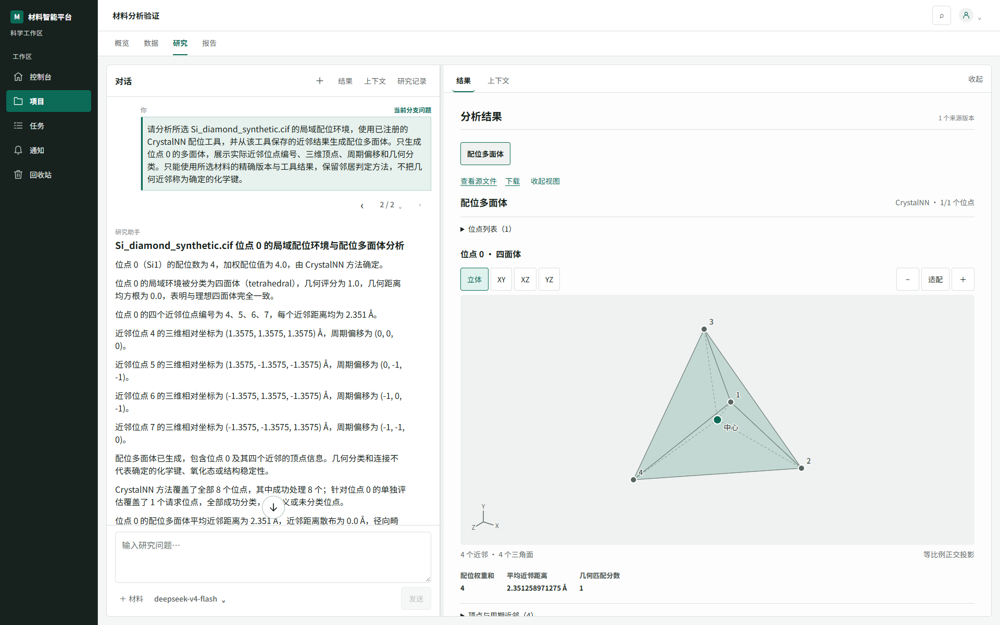
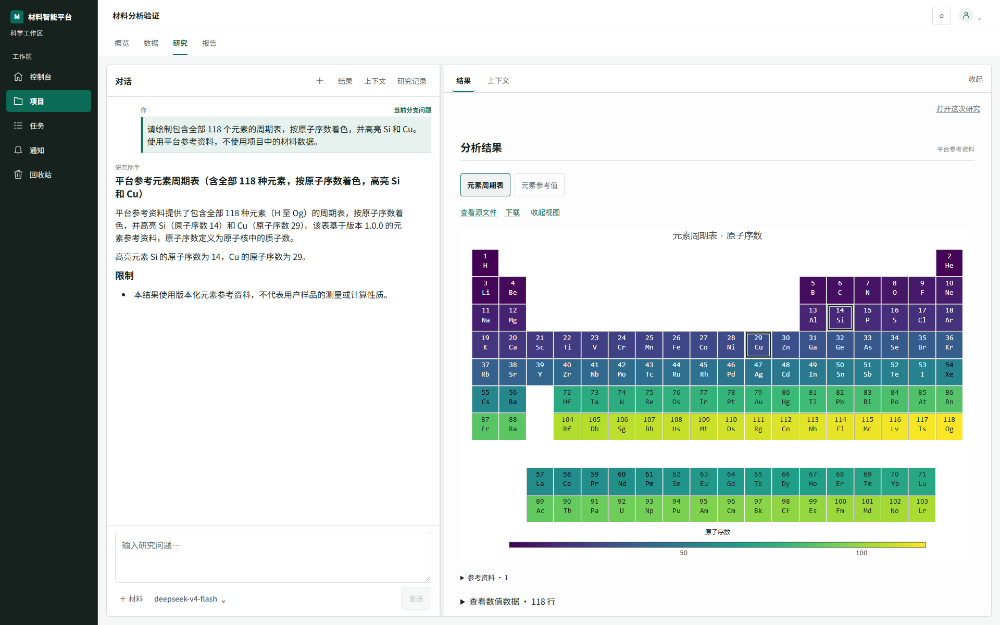
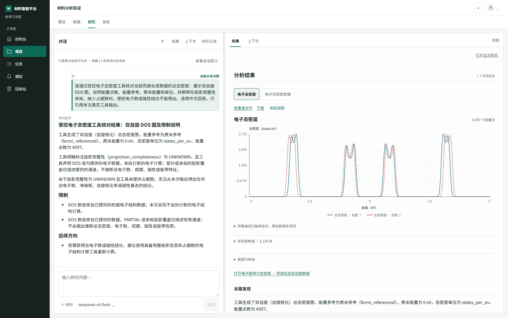
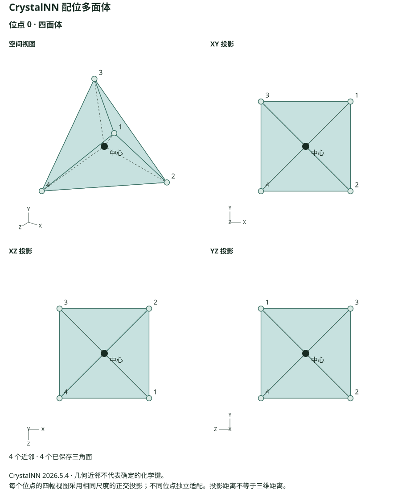
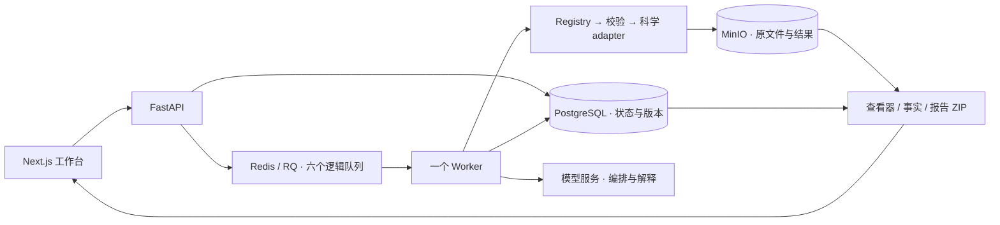

# Material Data Intelligence

[](https://github.com/foolkking/material-data-intelligence/actions/workflows/ci.yml)

**从材料数据到可追溯的科学回答与报告。** MDI 将版本化数据、科学查看器、受控计算工具和对话式 Research 放在同一个工作台中。你可以分析上传的结构或轨迹，也可以直接进行元素查询、组成计算、文本绘图和理想晶格生成。

[当前能力](CAPABILITIES.md) · [剩余工作与交接](REMAINING_WORK.md) · [架构与状态](PROJECT_STATE.md) · [开发约定](AGENTS.md)

## 系统特性实览

### 研究对话与三维材料结果



*来自已运行工作区的真实 Research 截图：回答引用所选 CIF 的精确版本与已保存的 CrystalNN 近邻，右侧展示据此生成的三维配位多面体。*

### 无需上传材料：118 元素周期表



*使用平台版本化元素参考数据生成 118 元素周期表，可高亮和比较元素；无需先上传材料。*

### 电子态密度图与结论边界



*图表直接呈现保存的双自旋 DOS 数据；回答说明投影完整性未知，因此不推断总电子数、磁性或能带特征。*

## 功能概览

- **从精确版本出发**：结构、轨迹、电子、声子、XRD、RDF、体数据和表格使用各自的解析与查看器；多材料研究保留每个来源的版本与角色。
- **可检查的 Research**：流式 Markdown、公式和表格；编辑问题创建分支；上下文入口展示实际输入、工具调用、保存结果及引用事实。
- **有执行边界的科学工具**：当前有 69 个注册工具、36 个研究能力、38 个研究需求合同。模型提出结构化调用，Registry/schema 校验后由 adapter 执行。
- **不上传材料也能开始**：周期表、元素比较、单位换算、化学式组成、有界函数曲线、内联数值绘图和理想晶格，另支持知识与方法对话。
- **保存结果的交互展示**：结构与周期近邻、局域配位多面体和多类科学图表；3D 视图支持等比例适配、旋转与选择。几何近邻与确定化学键明确区分。
- **报告可带走**：报告 ZIP 可包含 HTML、Markdown、SVG 图、原始结果、复现信息及 SHA-256 清单，图表链接使用包内相对路径。
- **任务可恢复，证据可追踪**：异步队列、持久执行状态、租约、取消与失败重试；解释引用保存事实，个人模型连接密钥在服务端加密。

项目仍在开发中。代表性科学流程已验收，但完整样例集、全站 UX 和浏览器原生下载仍有待办；具体支持边界与证据见 [CAPABILITIES.md](CAPABILITIES.md)，不要将工具总数理解为所有文件格式都已全面支持。



*报告导出图示例：合成 Si 位点 0 的四面体，图形来自保存的近邻坐标与表面。在线工作台还可旋转、选择顶点和检查周期偏移。*

## 架构



科学计算基于 pymatgen、ASE、pymatviz 等；浏览器使用 React、Three.js 和 Plotly。产品模型不获得任意 Python、shell、文件系统或网络执行权限。

## 快速上手（Windows 本地开发）

按顺序完成依赖安装、首次配置、服务初始化，即可进入工作台。已有项目数据时，请先备份；`init` 不覆盖现有配置，`migrate` 不清空既有目录。

以下流程使用 PowerShell 7 和仓库自带的本地服务控制器。Linux CI 会测试 Python/前端代码；目前没有经过同等验证的一键 Linux、macOS 或生产部署流程。

### 1. 安装依赖

| 依赖 | 用途与要求 |
|---|---|
| Git、[PowerShell 7](https://learn.microsoft.com/powershell/scripting/install/installing-powershell-on-windows) | 克隆与服务控制 |
| [Python](https://www.python.org/downloads/) 3.11+、[uv](https://docs.astral.sh/uv/getting-started/installation/) | Python 依赖；CI 使用 3.12 |
| [Node.js](https://nodejs.org/en/download) 22、npm | 前端；Node 22 是 CI 基线 |
| [PostgreSQL 17](https://www.postgresql.org/download/windows/) | 需要 `pg_ctl.exe`、`initdb.exe`、`postgres.exe` |
| [Memurai](https://www.memurai.com/) 或兼容 Redis 的 Windows 服务端 | 需要可直接启动的 `memurai.exe` 或 `redis-server.exe` |
| [MinIO 服务端](https://github.com/minio/minio#install-from-source) | 需要 `minio.exe`；`mc.exe` 客户端不能替代服务端 |
| [Go](https://go.dev/dl/) | 按 MinIO 官方源码方式安装服务端时需要 |

#### 逐项安装和配置

下面的组件由本机提供，项目不会把数据库、Redis、MinIO 或 Node.js 打包进仓库。安装器的默认位置可以保留；只有命令不在 PATH 时，才把绝对路径填入外部 `local.env`。

1. **Python 与 uv**：安装 Python 3.11 或更高版本，再按 [uv 安装说明](https://docs.astral.sh/uv/getting-started/installation/) 安装 uv。`uv sync --locked --extra test` 会在仓库内创建 `.venv`。若电脑有多个 Python，设置 `MDI_PYTHON` 为该虚拟环境的 `python.exe`，否则控制器优先使用仓库 `.venv`。
2. **Node.js 与 npm**：安装 Node.js 22 LTS，npm 会随安装器一起提供。默认安装通常已经把 `node.exe` 和 `npm.cmd` 加入 PATH；否则设置 `MDI_NODE_EXE` 和 `MDI_NPM_EXE`，两项分别指向实际文件。安装前端依赖使用 `npm --prefix apps/web ci`，不要混用 pnpm 或 yarn。
3. **PostgreSQL**：使用 Windows 安装器安装 PostgreSQL 17，确认安装目录的 `bin` 下同时有 `pg_ctl.exe`、`initdb.exe` 和 `postgres.exe`。把这个 `bin` 目录加入 PATH，或设置 `MDI_POSTGRES_BIN=C:/Program Files/PostgreSQL/17/bin`。MDI 会在 `MDI_DATA_ROOT/postgres` 创建自己的集群并使用 `POSTGRES_PORT`（默认 55434）；安装器自带的系统服务可以保持停止，也不会被 MDI 接管。
4. **Redis 兼容服务端**：Windows 可使用 Memurai，或者提供 `redis-server.exe` 的兼容发行版。配置 `MDI_REDIS_EXE` 为服务端可执行文件，而不是 `redis-cli.exe`；也可把它加入 PATH。控制器会生成受控配置并让实例使用 `REDIS_URL` 中的端口（默认 6380）和 `MDI_DATA_ROOT/redis`。
5. **MinIO 服务端**：需要 `minio.exe`，`mc.exe` 只是客户端，不能替代服务端。按 [MinIO 官方源码安装说明](https://github.com/minio/minio#install-from-source) 安装 Go 后，在 PowerShell 运行 `go install github.com/minio/minio@latest`。默认可执行文件位于 `$env:USERPROFILE\go\bin\minio.exe`；如果安装了自定义 `GOBIN`，以 `go env GOBIN` 的目录为准。将实际文件路径填入 `MDI_MINIO_BIN`。控制器会使用 `MDI_DATA_ROOT/minio`、`MINIO_ENDPOINT`（默认 9000）和控制台端口 9001，`migrate` 负责创建 bucket。项目不会下载或捆绑这些服务端软件。

   **维护状态**：MinIO 官方仓库目前标注不再维护，社区版仅提供源码且采用 AGPLv3。MDI 本地控制器直接启动 `minio.exe`，当前没有为其他对象存储提供同等的本地安装/进程管理流程；使用前请核对该依赖的维护状态与许可证要求。
6. **Git 与 PowerShell 7**：Git 用于获取源码，PowerShell 7 用于执行 `scripts/dev.ps1`。在 Windows Terminal 中选择 `pwsh`，不要用旧版 Windows PowerShell 作为长期运行环境。

安装完后可以一次性检查版本和可执行文件：

```powershell
git --version
pwsh --version
uv --version
python --version
node --version
npm --version
pg_ctl --version
initdb --version
Get-Command memurai.exe,redis-server.exe,minio.exe -ErrorAction SilentlyContinue
```

若某个命令没有输出，先不要修改代码：把对应实际路径写入第 3 步生成的 `local.env`，再运行 `.\scripts\dev.ps1 doctor`。PostgreSQL、Redis 和 MinIO 的版本命令可能随发行版显示为 `memurai --version` 或 `redis-server --version`；关键是 `doctor` 能解析到可执行文件。第三方组件遵循各自许可证。

### 2. 克隆并安装项目

```powershell
git clone https://github.com/foolkking/material-data-intelligence.git
cd material-data-intelligence
uv sync --locked --extra test
npm --prefix apps/web ci
```

Python 依赖以 `pyproject.toml` / `uv.lock` 为准；前端以 `apps/web/package-lock.json` 为准，使用 npm。上面的命令创建仓库内 `.venv`；运行时数据与临时文件保持在仓库外。安装不需要手动设置临时目录或包缓存目录，uv 与 npm 会使用各自的默认缓存位置。

### 3. 生成配置并检查

```powershell
# 默认不需要修改任何路径：控制器会自动使用仓库同级的 <仓库目录名>.local。
.\scripts\dev.ps1 init
$localRoot = Join-Path (Split-Path $PWD -Parent) "$((Split-Path $PWD -Leaf)).local"
notepad (Join-Path $localRoot 'local.env')
.\scripts\dev.ps1 doctor
```

`init` 从 [.env.example](.env.example) 生成外部 `local.env`。除了随机数据库密码、MinIO 密码、首个管理员密码和 Fernet 加密密钥，还会把 `MDI_LOCAL_ROOT`、`MDI_DATA_ROOT`、`MDI_RUNTIME_ROOT`、`MDI_LOG_ROOT`、`MDI_TEMP_ROOT`、`MDI_CACHE_ROOT`、`MDI_NEXT_DIST_DIR` 和 `MDI_ARTIFACT_ROOT` 写成当前外部根下的绝对路径；已有文件不会被覆盖。配置和密码只保存在本地文件，不打印到终端。请使用纯 `KEY=value`，不加引号或变量插值。

这里的 `$localRoot` 只是为了用记事本打开配置；默认启动、迁移和状态命令会自行计算同一个根，不需要每次设置环境变量。需要自定义时，先设置一个仓库外绝对路径并在后续会话中沿用：`$env:MDI_LOCAL_ROOT = 'D:/mdi-local/material-data-intelligence.local'`。不要把 `local.env` 放回 Git 仓库。

如果二进制未加入 PATH，在 `local.env` 的可选项中填写实际绝对路径：`MDI_POSTGRES_BIN` 是 PostgreSQL 的 bin 目录，其余 `MDI_*_EXE` / `MDI_*_BIN` 是对应可执行文件。带空格的目录可以使用。`doctor` 检查配置、依赖、外部路径和端口归属，不启动服务。

### 配置数据目录与程序路径

`init` 已将所有本机数据目录写入 `local.env`。通常保留默认值即可；如果需要把持久数据放到容量更大的磁盘，编辑这些字段为新的绝对路径。路径不能指向仓库内部，`local.env` 也必须留在 `MDI_LOCAL_ROOT` 下：

```dotenv
MDI_LOCAL_ROOT=D:/mdi-local/material-data-intelligence.local
MDI_DATA_ROOT=D:/mdi-local/material-data-intelligence.local/data
MDI_ARTIFACT_ROOT=D:/mdi-local/material-data-intelligence.local/data/artifacts
MDI_RUNTIME_ROOT=D:/mdi-local/material-data-intelligence.local/run
MDI_LOG_ROOT=D:/mdi-local/material-data-intelligence.local/logs
MDI_CACHE_ROOT=D:/mdi-local/material-data-intelligence.local/cache
MDI_NEXT_DIST_DIR=D:/mdi-local/material-data-intelligence.local/cache/next
MDI_TEMP_ROOT=D:/mdi-local/material-data-intelligence.local/tmp
```

这些是路径示例，请按实际磁盘修改；配置文件不支持 `$env:...`、`%VARIABLE%` 或引号。数据库和对象存储已有数据时，改路径不会搬迁数据，应先停服务并按“数据在哪里”备份、恢复到新目录，再启动。

如果程序不在 PATH，再填写对应安装位置。下面只展示格式，文件位置按实际安装结果替换：

```dotenv
MDI_POSTGRES_BIN=C:/Program Files/PostgreSQL/17/bin
MDI_REDIS_EXE=C:/tools/redis/redis-server.exe
MDI_MINIO_BIN=D:/tools/minio.exe
MDI_PYTHON=E:/code/material-data-intelligence/.venv/Scripts/python.exe
MDI_NODE_EXE=C:/Program Files/nodejs/node.exe
MDI_NPM_EXE=C:/Program Files/nodejs/npm.cmd
```

保存后重新运行 `.\scripts\dev.ps1 doctor`。`start`、`stop`、`restart`、`migrate` 都会从同一份 `local.env` 读取配置；换了自定义 `MDI_LOCAL_ROOT` 时，在新 PowerShell 窗口先设置该根，再调用控制器。

**默认值意味着什么**：第一次运行 `init` 会自动创建仓库同级的 `<仓库目录名>.local`，并把 `local.env`、`data`、`run`、`logs`、`cache`、Next.js 输出、`tmp` 和本地 artifact 目录写进去；新手只需要安装依赖、执行 `init`、`doctor`、`migrate`、`start`。Next.js 要求输出目录使用项目内的相对名称，控制器会把它接到 `.local/cache/next`，实际缓存仍在仓库外。只有磁盘空间不足、需要换盘或程序不在 PATH 时才编辑配置。

### 4. 初始化并启动

```powershell
.\scripts\dev.ps1 migrate
.\scripts\dev.ps1 start
.\scripts\dev.ps1 status
```

`migrate` 启动项目自己的存储服务，首次运行会初始化空 PostgreSQL 集群、创建数据库、执行完整 Alembic 迁移并创建 MinIO bucket。它拒绝在本项目 API 或 Worker 仍运行时迁移。再次执行会保留数据；不会清空已有目录。

`start` 检查迁移版本和 bucket，再启动 API、一个消费六队列的 Worker 和前端。失败时检查日志并修正后重试；已成功启动的依赖保留，必要时用 `stop` 停止本项目实例。控制器不会接管仅因占用了相同端口而被发现的外部服务。

成功标志是 `doctor` 输出 `Dependencies, paths and port ownership verified.`，`status` 表中的 PostgreSQL、Redis、MinIO、FastAPI、Next.js 均为 `True`，并显示 `Worker: idle`。如果 `doctor` 报缺少二进制，只需按上一节把对应路径写入 `local.env`，不需要改代码。

打开 **[http://127.0.0.1:3023](http://127.0.0.1:3023)**。使用 `local.env` 的 `MDI_LOCAL_USER_EMAIL` 与 `MDI_LOCAL_USER_PASSWORD` 登录；默认邮箱为 `admin@example.invalid`，密码是每次新安装独立生成的。首次成功登录创建管理员；之后可在账户页修改密码，在管理页邀请用户。修改 bootstrap 环境变量不会替换已创建账户的密码。

### 5. 连接模型，开始研究

1. 先按下方“配置 MiMo 模型”连接自己的模型服务，或使用管理员已授权的平台模型。
2. 创建项目。上传材料后选择精确版本进入 Research，或直接提出不需要样品的问题，例如“生成 Si 的 diamond 理想晶格，晶格常数 5.43 Å”。
3. 查看工具结果与来源，生成报告后使用 ZIP 下载。

仓库不提供模型服务或 API Key；模型调用依赖你配置的提供方，可能产生其服务费用。数据管理与已有结果浏览不要求先发起模型调用。

### 配置 MiMo 模型

MiMo 是用户自己的模型服务连接，**不写入 `.env` 或 `local.env`**。密钥在账户模型设置中提交后由服务端加密保存，不会回显；不同账户的个人连接相互隔离。

1. 在 [MiMo API 开放平台](https://platform.xiaomimimo.com/) 注册并开通 API，在平台控制台查看 API 文档、API Base URL 和当前可用模型。地址、调用格式和模型清单会随服务版本或账户区域变化，以控制台当前提供的 OpenAI 兼容 API 根地址为准。
2. 登录 MDI，打开“模型设置”→“添加连接”。服务名称填写 `MiMo`，服务地址填 API Base URL，服务密钥填刚创建的 API Key。
3. 打开“高级设置”，选择 `OpenAI Chat Completions · JSON 模式`，保存连接。不要在 Base URL 后重复填写 `/chat/completions`；模型发现调用的是 Base URL 下的 `/models`。
4. 点击“获取模型列表”，勾选研究时需要的模型，再点“保存模型选择”。研究时从模型选择器中选用刚保存的模型。
5. 先发起一个简单问题确认连接，例如“列出硅的元素符号和原子序数”。成功后再运行结构或报告任务。如果服务商明确不支持 JSON 模式，在模型设置中把协议改为 `OpenAI Chat Completions · 普通文本` 后重新保存并测试。

若获取模型列表返回 401，检查 API Key 和账户权限；403 通常表示权限或地区限制；404 检查是否填了 API 根地址而不是控制台、模型或聊天页面地址。列表可获取但对话失败时，确认选中模型具备聊天能力与结构化输出能力，并检查服务额度。不要把 API Key 发给支持人员或写进截图、日志和 Git。

### 在浏览器中打开导出的报告

在报告页面选择“导出 ZIP（含图表）”，解压到一个完整文件夹，再用浏览器打开其中的 `report.html`。保留解压后的 `figures/`、`artifacts/` 等目录结构；HTML 通过相对路径读取图表与附件，直接在压缩包预览 HTML 可能看不到图。报告是静态页面，可离线阅读；交互式三维查看仍在 MDI 工作台中进行。

## 配置与默认端口

配置文件默认位于**仓库同级的 `<仓库目录名>.local/local.env`**，不在仓库根目录。`init` 会把它使用的绝对根和所有派生目录写入这个文件；之后控制器从同一份配置读取路径。若要自定义，先在当前 shell 设置 `$env:MDI_LOCAL_ROOT='D:/mdi-local'`，再运行 `init`，并在之后的 PowerShell 会话中设置同一个值。

| 配置 | 默认值 / 作用 |
|---|---|
| `POSTGRES_HOST` / `POSTGRES_PORT` | `127.0.0.1` / `55434` |
| `POSTGRES_DB` / `POSTGRES_USER` / `POSTGRES_PASSWORD` | `mdi` / `mdi` / 随机生成；数据库 URL 自动正确转义 |
| `REDIS_URL` | `redis://127.0.0.1:6380/0` |
| `MINIO_ENDPOINT` / `MDI_MINIO_CONSOLE_PORT` | `http://127.0.0.1:9000` / `9001` |
| `MINIO_BUCKET` | `mdi-artifacts` |
| `MDI_API_PROXY_TARGET` | `http://127.0.0.1:8005`；浏览器通过同源 `/api` 访问 |
| `MDI_WEB_PORT` / `MDI_CORS_ORIGINS` | `3023` / 对应前端源；改端口时同步修改 |
| `MDI_PROVIDER_ENCRYPTION_KEY` | 稳定 Fernet 密钥；API 与 Worker 共用，必须随恢复配置备份 |
| `MDI_LOCAL_USER_*` | 首次本地管理员身份、密码与角色 |
| `MDI_LOCAL_ROOT` | 外部 `local.env` 和项目所有本地运行目录的根；必须在仓库外 |
| `MDI_DATA_ROOT` | PostgreSQL、MinIO 和 Redis 持久数据目录 |
| `MDI_ARTIFACT_ROOT` | 使用本地 artifact 存储后端时保存的结果目录 |
| `MDI_RUNTIME_ROOT` / `MDI_LOG_ROOT` / `MDI_CACHE_ROOT` / `MDI_TEMP_ROOT` | 运行态、日志、观测缓存和临时目录；`init` 默认都位于 `<local-root>` 下 |
| `MDI_NEXT_DIST_DIR` | Next.js 构建与开发输出；控制器将项目要求的相对目录映射到此仓库外路径 |
| `MDI_POSTGRES_BIN` / `MDI_REDIS_EXE` / `MDI_MINIO_BIN` / `MDI_PYTHON` / `MDI_NODE_EXE` / `MDI_NPM_EXE` | 可选可执行文件路径；留空时从 PATH 或项目 `.venv` 查找 |
| `OPENBLAS_NUM_THREADS` / `OMP_NUM_THREADS` / `MKL_NUM_THREADS` / `NUMEXPR_NUM_THREADS` | 新配置默认为 `1`，限制本地科学计算线程 |

不要轮换加密密钥来“修复”模型连接：旧密钥丢失会导致已保存的连接凭据无法解密。历史 `MDI_DATABASE_URL`、`MDI_POSTGRES_*`、`MDI_REDIS_URL` 仍兼容，但与规范配置同时存在时必须一致；新配置避免重复填写。

本地控制器仅管理 loopback 服务，不是公网生产部署器。API 直接启动不会自动读取 `.env` 或外部 `local.env`，正常使用统一通过 `dev.ps1` 加载。

当前依赖审计仍有待处理项，见 [剩余工作第 1 项](REMAINING_WORK.md#1-产品框架与主要页面--p0)。不要将本地启动成功或 CI 通过当作生产安全验收。

## 日常操作与升级

```powershell
.\scripts\dev.ps1 status
.\scripts\dev.ps1 restart -Scope app       # 仅 API / Worker；须验证 Worker 空闲
.\scripts\dev.ps1 restart -Scope frontend  # 仅前端
.\scripts\dev.ps1 restart                  # 整套项目服务
.\scripts\dev.ps1 stop                     # 保留数据，停止项目进程
```

应用重启会先检查并排空空闲 Worker；执行中任务不会被该命令强行终止。整栈 `stop` / `restart` 会中断服务，先等待任务完成。控制器根据状态记录、进程身份、启动时间和数据目录核验归属；不会按端口直接杀进程。

升级代码前先备份数据，在任务结束后：

```powershell
.\scripts\dev.ps1 stop
git pull --ff-only
uv sync --locked --extra test
npm --prefix apps/web ci
.\scripts\dev.ps1 doctor
.\scripts\dev.ps1 migrate
.\scripts\dev.ps1 start
```

恢复检查默认每分钟执行，停滞窗口默认 15 分钟（最小 5 分钟）；执行任务还要满足数据库租约过期才会被判定失效。已有问题与文件保留，失败 Job 需要明确重试。可用 `MDI_AGENT2_STARTUP_RECOVERY_ENABLED` 控制启动和周期恢复。

## 数据在哪里

| 位置（相对 `<local-root>`） | 内容 |
|---|---|
| `local.env` | 服务凭据、路径、首个账户配置和模型连接加密密钥 |
| `data/postgres` | 账户、项目、数据版本、Research、任务、结果关系和报告记录 |
| `data/minio` | 上传原文件、科学产物和报告对象；bucket 默认 `mdi-artifacts` |
| `data/redis` | 项目 Redis 目录；默认无 AOF，持久执行状态以 PostgreSQL 为准 |
| `cache` | MinIO 容量观测等可重建缓存，不是权威数据 |
| `run/state/services.json` | 项目进程归属记录 |
| `logs` | API、Worker、前端及依赖日志 |
| `tmp` | 可独立指定的测试与临时工作目录 |

备份使用 PostgreSQL 的 `pg_dump` 等一致性备份方式，或停止服务后备份完整数据目录；MinIO 要保留整个数据目录及内部元数据。将 `local.env` 安全保存在备份中。只复制 Git 仓库无法恢复项目数据；更改路径变量也不会搬迁旧数据。

## 常见问题

- **命令被 PowerShell 执行策略拦截**：按本机组织策略允许运行可信本地脚本；可在获准时使用 `pwsh -NoProfile -ExecutionPolicy Bypass -File scripts/dev.ps1 doctor`，无需永久修改系统策略。
- **端口冲突或 PostgreSQL 无法绑定**：修改 `local.env` 对应端口；Windows 可用 `netsh interface ipv4 show excludedportrange protocol=tcp` 检查保留端口。不要关闭不属于项目的服务。
- **迁移版本不匹配 / bucket 不存在**：等待任务结束，执行 `stop` → `migrate` → `start`。不要删除数据库或 migration 文件。
- **页面能开但任务不执行**：查看 `status` 中 Worker 是否 ready，检查 `logs/worker.err.log`、模型设置与对应任务错误。
- **模型连接无法解密**：确认 API / Worker 使用原有同一份 `MDI_PROVIDER_ENCRYPTION_KEY`；不要重新生成它覆盖旧值。

## 开发与检查

在仓库根目录运行以下检查。Pytest 会自动将测试临时文件和缓存放到仓库外的 `<repo>.local/tmp`；**不要为单元测试导入真实 `local.env`**：

```powershell
uv run --locked --extra test python -m pytest -m "not integration and not live_llm and not llm_integration"
npm --prefix apps/web test
npm --prefix apps/web run typecheck
```

如需将项目临时文件迁到其他盘，可在外部 `local.env` 设置 `MDI_TEMP_ROOT`；`scripts/dev.ps1` 会自动同步 Windows/Python 临时变量。`TEMP`、`TMP`、`TMPDIR` 以及 `UV_CACHE_DIR`、`npm_config_cache` 都不是安装必填项。需要生产构建时，在隔离 checkout 中执行 `npm --prefix apps/web run build`，避免覆盖正在运行的开发前端输出；CI 使用独立 checkout。内存有限时串行执行测试、typecheck、build，并按需设置 `$env:NODE_OPTIONS='--max-old-space-size=1024'`。

## 仓库入口

| 目录 / 文件 | 作用 |
|---|---|
| [apps/api](apps/api) | FastAPI、认证、持久化、Research 编排与迁移 |
| [apps/web](apps/web) | Next.js 工作台、科学查看器与报告 |
| [packages](packages) / [tool_registry](tool_registry) | schema、工具合同、adapter、parser 和 artifact |
| [services/workers](services/workers) / [services/llm](services/llm) | 六队列执行与有界模型调用 |
| [scripts](scripts) | 本地服务控制器与首次运行助手 |
| [tests](tests) | 行为、合同与集成测试 |
| [CAPABILITIES.md](CAPABILITIES.md) / [REMAINING_WORK.md](REMAINING_WORK.md) | 序号一一对应的已有能力与后续交接 |

贡献前请阅读 [AGENTS.md](AGENTS.md)。修复应附与风险相符的验证；新增科学能力需同时维护执行合同、来源语义和结果展示。当前仓库未声明项目许可证，第三方依赖许可证与本项目授权是不同事项。
